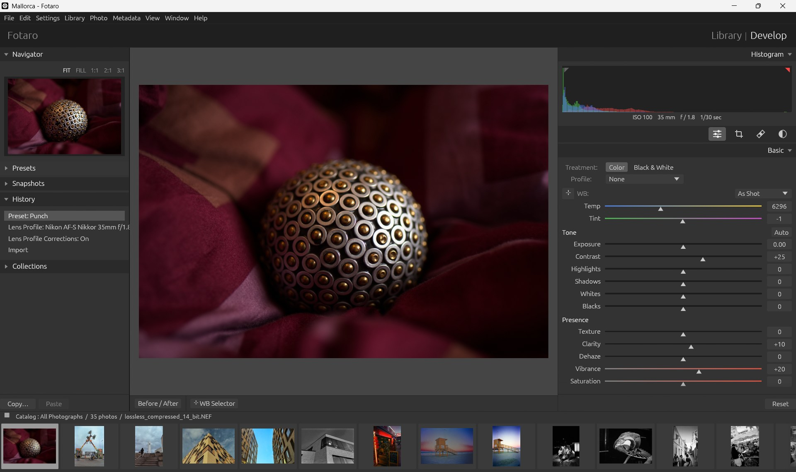
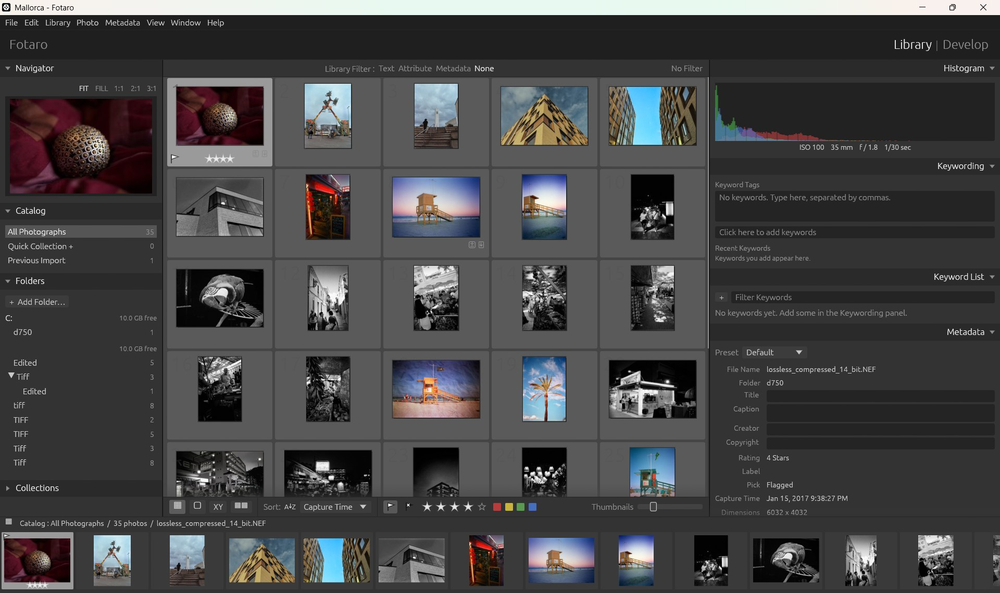
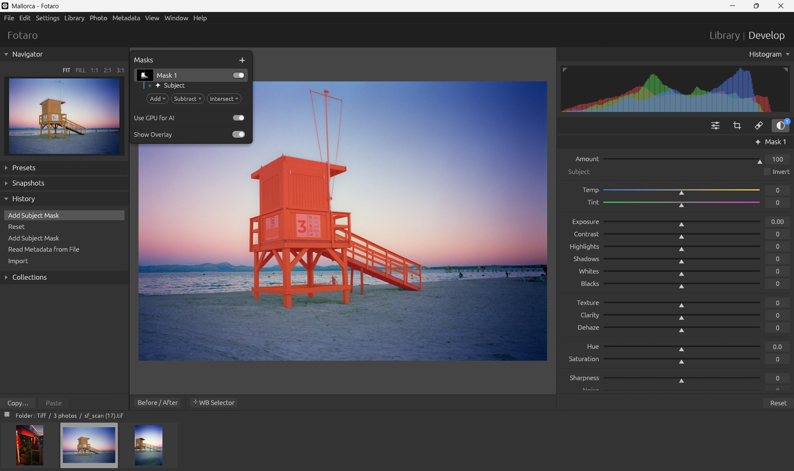
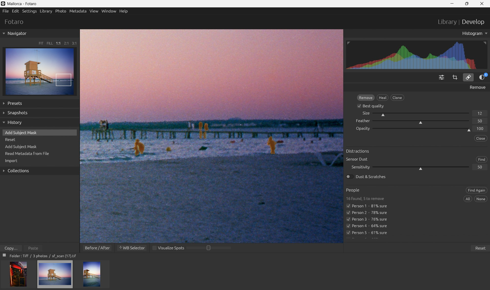

# Fotaro

**Fotaro is a free photo organiser and RAW editor for your desktop.** Keep your whole photo
collection in one place, find any picture in seconds, and develop your RAW files, without a
subscription and without uploading anything anywhere.



## Familiar, but not a copy

If you have used Adobe Lightroom Classic, Fotaro should feel like home: a **Library** for
organising, a **Develop** module for editing, panels in the places you expect, and most of the
keyboard shortcuts you already know.

Fotaro is **not** meant to be a Lightroom clone, though. It borrows what works and makes its own
choices where it thinks it can do better, so the way some tasks flow, some shortcuts and some of
the thinking behind features will differ from Lightroom, and may drift further apart over time.
A few examples:

- Everything, including the AI tools, runs on your own computer. There is no account and no cloud.
- Some tools Lightroom doesn't have, such as cleaning dust and scratches from film scans using
  the scanner's infrared pass.
- Small workflow changes, such as Ctrl+drag (as well as Space+drag) to pan a zoomed photo, which
  also works on laptops whose pointing devices ignore clicks while a key is held.

Your original photos are never changed. Your ratings, keywords and edits live in Fotaro's
catalog, and can also be written to XMP sidecar files that Lightroom, Bridge and darktable read.

## What you can do

### Organise (Library)



- **Import** from folders or memory cards: add photos where they are, or copy or move them into
  dated folders, renaming them on the way and skipping duplicates.
- **Browse** in a grid, look closer in the loupe (with 1:1 zoom), and compare photos side by side
  or several at once.
- **Cull fast from the keyboard**: pick or reject, rate with stars, add colour labels.
- **Find anything**: keywords, collections, smart collections, and a filter bar that searches
  text, ratings, flags, cameras, lenses and dates.
- **Stack** related shots, pair RAW and JPEG files, and make virtual copies to try different
  edits of the same photo.
- **Edit In** other apps (NegPy for film negatives, Luminar, darktable): the result comes back
  stacked with the original.
- **Export** to JPEG or TIFF with resizing, sharpening, renaming, watermarks and metadata
  choices, or with a saved export preset.

### Edit (Develop)

- **The essentials**: white balance, exposure, contrast, highlights, shadows, whites and blacks,
  texture, clarity, dehaze, vibrance and saturation, with Auto for a quick start.
- **Colour**: tone curve, HSL / colour mixer, black & white mix, colour grading, and 3D LUTs
  (`.cube`) as profiles.
- **Detail**: sharpening and noise reduction, with a 1:1 preview box.
- **Lens corrections**: automatic distortion, vignetting and chromatic aberration correction from
  the open [Lensfun](https://lensfun.github.io/) lens database (downloaded the first time you use
  it), plus manual corrections and defringe.
- **Geometry**: crop and straighten, perspective correction with Upright (automatic or guided).
- **Effects**: post-crop vignette, grain and glow.
- **Local adjustments with masks**: brush, linear and radial gradients, and AI masks that select
  the subject, the sky, the background or any object you point at.
- **Remove**: heal and clone spots, fill larger areas with content-aware AI, remove sensor dust,
  clean dust and scratches from film scans, and remove people from a photo.
- **Presets and snapshots**: save your own looks, import your Lightroom presets (`.xmp` and
  `.lrtemplate`), preview a preset by hovering over it, keep snapshots, and step back through
  the full history. Copy and paste settings between photos.





The AI tools (masks, content-aware fill, dust and people removal) download their models the first
time you use them, after asking you. They use your graphics card when they can.

*The ornamental ball is a Nikon D750 sample from [raw.pixls.us](https://raw.pixls.us/) (CC0); the
beach photos are 35 mm film scans.*

## Getting Fotaro

Fotaro is in active development and there are no ready-made downloads yet, so for now you build
it yourself. It is developed and tested on **Windows 11**. macOS and Linux are planned but not
tested at the moment.

You need:

1. [Rust](https://www.rust-lang.org/tools/install) (the installer sets everything up).
2. A C++ compiler: on Windows, the
   [Visual Studio Build Tools](https://visualstudio.microsoft.com/visual-cpp-build-tools/)
   with "Desktop development with C++".
3. [Git](https://git-scm.com/).

Then, in a terminal:

```sh
git clone --recurse-submodules https://github.com/jboneng/ImageLibrary.git
cd ImageLibrary
cargo run --release -p fotaro
```

The first build takes several minutes. Later starts are quick.

When Fotaro opens, create a catalog (the file that remembers your photos, ratings and edits),
then choose **Import** or **Add Folder** to bring in your photos.

## Keyboard shortcuts

Most of Lightroom Classic's shortcuts work: **G** grid, **E** loupe, **D** develop, **P / X / U**
flags, **0 to 5** stars, **6 to 9** colour labels, **R** crop, **Q** remove, **Ctrl+Z** undo, and
many more. The full list is in [docs/SHORTCUTS.md](docs/SHORTCUTS.md); in the app, press
**Ctrl+/** (or use the Help menu) to see them.

## Licence

Fotaro is free software: you can redistribute it and/or modify it under the terms of the
[GNU General Public License](LICENSE) as published by the Free Software Foundation, either
version 3 of the License, or (at your option) any later version. It is distributed in the hope
that it will be useful, but WITHOUT ANY WARRANTY; without even the implied warranty of
MERCHANTABILITY or FITNESS FOR A PARTICULAR PURPOSE. See the [LICENSE](LICENSE) file.

Fotaro is not affiliated with or endorsed by Adobe. Adobe and Lightroom are trademarks of Adobe
Inc.

### Third-party licences

- **LibRaw**, which reads RAW files, is dual-licensed LGPL-2.1 / CDDL-1.0; Fotaro uses and
  statically links it under **LGPL-2.1** (CDDL is not compatible with the GPL). Its unmodified
  source is in `crates/libraw/vendor/LibRaw`.
- **Lensfun's lens database** (CC BY-SA 3.0) and the **AI models** (each under its own licence,
  some for non-commercial use only) are downloaded on first use, not shipped with Fotaro.

## For developers

Fotaro is written in Rust with [egui](https://github.com/emilk/egui). The roadmap and design notes
are in [docs/PLAN.md](docs/PLAN.md).

```sh
cargo run -p fotaro                   # the app (debug build; the image code is still optimised)
cargo test --workspace                # tests
cargo run -p fotaro -- --catalog <dir.plcat> --add <folder>   # open a catalog, import a folder
cargo run -p libraw --example rawinfo --release -- <raw files>   # RAW decode check
cargo run -p imaging --example renderbench --release -- <file>   # Develop render timings
```

If you cloned without `--recurse-submodules`, run `git submodule update --init` to fetch LibRaw.

| Path             | Purpose                                                              |
|------------------|----------------------------------------------------------------------|
| `crates/app`     | The application: windows, panels, tools (binary `fotaro`)            |
| `crates/catalog` | SQLite catalog: schema, migrations, folder sync, queries             |
| `crates/imaging` | Decoding, previews, the Develop pipeline, export                     |
| `crates/libraw`  | Safe Rust wrapper and C++ shim over the vendored LibRaw 0.22.3       |
| `crates/lensdb`  | The Lensfun lens database: download, matching, corrections           |
| `crates/segment` | AI models: masks, content-aware fill, dust and people detection      |
| `crates/xmp`     | XMP sidecars: read and update in place (Lightroom, Bridge, darktable) |
